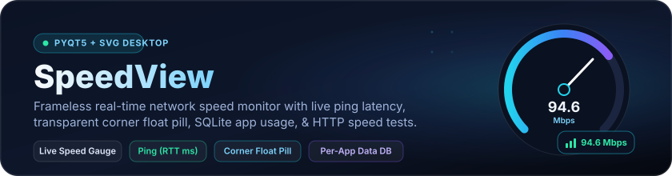
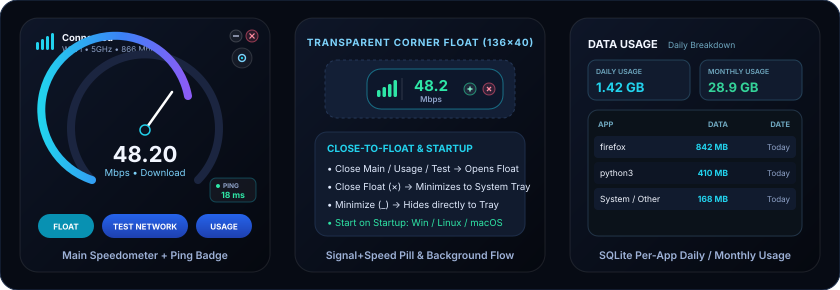

<div align="center">



<br />
<br />

[](https://www.python.org/)
[](https://riverbankcomputing.com/software/pyqt/)
[](.github/workflows/ci.yml)
[](.github/workflows/release.yml)
[](LICENSE)

**Cross-platform desktop network monitor built with Python, PyQt5, and live hardware-accelerated SVG.**

[Features](#features) · [UI Showcase](#ui-showcase) · [Window Lifecycle](#window-lifecycle--controls) · [Installation](#installation) · [Automated Release Build](#automated-release-build-pyinstaller) · [Configuration](#configuration--storage)

</div>

---

## UI Showcase

<div align="center">

</div>

---

## Features

| Area | Capabilities |
| :--- | :--- |
| **Frameless SVG Speedometer** | Deep-navy translucent rounded card with gradient active arc (`#22D3EE → #3B82F6 → #8B5CF6`), dynamic dial scaling, Download/Upload switching, and cogwheel gear settings trigger. |
| **Real-Time Ping / Latency** | Live TCP RTT measurement (`#pingBadge`) next to the speed gauge displaying millisecond latency (`ms`) with health color states (green `≤ 50 ms`, cyan `≤ 120 ms`, amber `> 120 ms`, rose `-- ms` offline). |
| **Transparent Corner Float Pill** | Ultra-compact `136×40` semi-transparent glass widget showing **only signal bars and speed**, anchored automatically in the bottom-right screen corner whenever opened, with drag support plus `+` expand and `×` close-to-tray controls. |
| **Real Interface Detection** | Automatically detects active **Ethernet**, **Wi-Fi** (real SSID, `2.4GHz` / `5GHz` / `6GHz` band, signal percentage), **Virtual**, or **Loopback** adapters with link speed and IPv4/IPv6 addresses across Linux, Windows, and macOS. |
| **Live File Speed Testing** | Real-time streaming download and chunked upload throughput test (`NetworkController.measure_file_speed`) against public CDN endpoints with `speedtest-cli` and `fast-cli` fallbacks. |
| **SQLite Data Usage (`App \| Data \| Date`)** | Per-process socket traffic attribution persisted in `data_usage.db`, presented in a frameless SVG window with `DAILY` / `MONTHLY` breakdowns and `RESET`. |
| **Modern Settings & Autostart** | High-contrast dark-navy Settings dialog with interface selector (`Auto-select` or manual), **Start SpeedView automatically on system startup** (Windows Registry / Linux XDG `.desktop` / macOS LaunchAgent), units (`Mbps`, `MB/s`, `Kbps`), alerts, and update controls. |
| **Background GitHub Auto-Updater** | Checks GitHub Releases **once every 3 days** (avoiding API rate limits), downloads OS-matching `.zip` updates into a temp folder in the background, and launches a detached helper script that waits for exit, swaps files cleanly, and restarts. |
| **System Tray Background Daemon** | Keeps tracking speed and app data usage continuously in the background with a dynamic speed badge icon, synced tooltip, quick menu actions, and threshold alerts. |

---

## Window Lifecycle & Controls

| Action | Resulting Behavior |
| :--- | :--- |
| **Close (`×`) on Main Window** | Hides the main speedometer and opens the **transparent corner Float widget**. |
| **Close (`×` / `CLOSE` / `Esc`) on Data Usage or Network Test** | Closes the active tool window and opens the **Float widget** cleanly. |
| **Close (`×` / `Esc`) on Float Widget** | Closes Float and **minimizes to the system tray**, keeping monitoring active in the background. |
| **Minimize (`−`) on Main Window** | Minimizes directly to the **system tray**. |
| **Usage (`USAGE`) Button** | Opens the `Data Usage` SVG window and hides the main window cleanly. |
| **Expand (`+`) on Float Widget** | Restores and focuses the full `MainWindow` speedometer. |
| **Tray `Exit`** | Shuts down all background timers/windows and exits cleanly. |

### Keyboard Shortcuts

| Shortcut | Action |
| :--- | :--- |
| <kbd>Ctrl</kbd> + <kbd>S</kbd> | Open **Settings** |
| <kbd>Ctrl</kbd> + <kbd>T</kbd> | Start **Network Speed Test** |
| <kbd>Ctrl</kbd> + <kbd>F</kbd> | Toggle **Floating Mode** |
| <kbd>Ctrl</kbd> + <kbd>U</kbd> / <kbd>Ctrl</kbd> + <kbd>H</kbd> | Open **Data Usage** (`App \| Data \| Date`) |
| <kbd>Esc</kbd> | Close current dialog / minimize Float widget to tray |

---

## Requirements

- **Python**: `3.8+` (CI & PyInstaller builds run on **Python 3.11**)
- **Operating Systems**: Windows 10/11, Linux (X11 / XWayland), macOS
- **Python Packages** (`requirements.txt`): `PyQt5`, `psutil`, `requests`, `speedtest-cli`, `packaging`, `pyinstaller` (plus `pywin32`, `winshell` automatically gated to `win32`)

On Debian/Ubuntu Linux, ensure Qt5 XCB/SVG runtime libraries are installed:
```bash
sudo apt-get update && sudo apt-get install -y --no-install-recommends \
  python3-pyqt5 python3-pyqt5.qtsvg python3-psutil python3-requests python3-packaging \
  libgl1 libxcb-xinerama0 libxkbcommon-x11-0 xvfb
```

---

## Installation

### 1. Run Prebuilt Release Binaries (Recommended for End Users)
Download the latest standalone binary or archive from the [**GitHub Releases**](https://github.com/zikani/speedview/releases) page:
- **Windows**: `SpeedView.exe` or `SpeedView-windows-x64.zip`
- **macOS**: `SpeedView-macos.zip` (`SpeedView.app`)
- **Linux**: `SpeedView-linux-x64.zip` (or `SpeedView-linux-x64` / `.tar.gz`)

Verify integrity using the accompanying `.sha256` file if desired.

### 2. Run from Source

```bash
git clone https://github.com/zikani/speedview.git
cd speedview

python -m venv .venv
# Linux / macOS:
source .venv/bin/activate
# Windows:
.venv\Scripts\activate

pip install -r requirements.txt
python main.py
```

---

## Automated Release Build (PyInstaller)

SpeedView includes an automated GitHub Actions release pipeline in [`.github/workflows/release.yml`](.github/workflows/release.yml) alongside continuous integration tests in [`.github/workflows/ci.yml`](.github/workflows/ci.yml).

### How Tag Releases Work
Whenever you push a semantic version tag matching `v*` (for example `v1.0.1`), GitHub Actions automatically:

1. **Verifies Code & Tests** on `ubuntu-latest` (under `xvfb-run`), `windows-latest`, and `macos-latest` (`QT_QPA_PLATFORM=offscreen`).
2. **Packages Standalone Releases** via [`speedview.spec`](speedview.spec) (`--windowed --collect-submodules speedview`):
   - Windows: `SpeedView.exe`, `SpeedView-windows-x64.zip` + `SpeedView-windows-x64.sha256`
   - macOS: `SpeedView-macos.zip` (`SpeedView.app`) + `SpeedView-macos.zip.sha256`
   - Linux: `SpeedView-linux-x64.zip`, `SpeedView-linux-x64`, `SpeedView-linux-x64.tar.gz` + `SpeedView-linux-x64.sha256`
3. **Publishes a GitHub Release** automatically with generated release notes and attaches all `.zip` bundles, binaries, and SHA-256 checksums.

```bash
# Bump APP_VERSION in speedview/config/config.py, commit, then push a tag:
git tag v1.0.1
git push origin v1.0.1
```

You can also trigger a dry-run build manually from the GitHub **Actions → SpeedView Release Build → Run workflow** button (`workflow_dispatch`) without creating a release.

### Build `SpeedView.exe` Locally on Windows

PyInstaller builds native Windows PE executables when executed on Windows (it does not cross-compile `.exe` binaries from Linux/macOS):

```bat
:: Option 1: Double-click or run the automated Windows build script (outputs dist\SpeedView.exe + .zip + .sha256)
scripts\build_windows.bat
```

```powershell
# Option 2: PowerShell script
.\scripts\build_windows.ps1

# Option 3: Direct PyInstaller build via speedview.spec
pip install -r requirements.txt
pyinstaller --noconfirm --clean speedview.spec
```

The standalone `dist\SpeedView.exe` and `dist\SpeedView-windows-x64.zip` are written to `dist\`.

### Local PyInstaller Build (Linux / macOS)
To package a standalone executable locally on Linux or macOS using [`speedview.spec`](speedview.spec):

```bash
pip install -r requirements.txt
pyinstaller --noconfirm --clean speedview.spec
```

---

## Configuration & Storage

Settings persist as JSON in your OS config folder:
- **Windows**: `%APPDATA%\NetworkSpeedMeter\network_speed_meter.conf`
- **Linux / macOS**: `$XDG_CONFIG_HOME/NetworkSpeedMeter/network_speed_meter.conf` (default `~/.config/NetworkSpeedMeter/network_speed_meter.conf`)

Per-app traffic totals persist in `data_usage.db` in the same folder.

| Key | Default | Description |
| :--- | :--- | :--- |
| `max_speed` | `100` | Maximum Download gauge scale (Mbps) |
| `max_upload` | `50` | Maximum Upload gauge scale (Mbps) |
| `update_interval` | `1.0` | Speed sampling interval in seconds |
| `speed_unit` | `"Mbps"` | Display unit (`Mbps`, `MB/s`, `Kbps`) |
| `show_upload_speed` | `false` | Show Upload instead of Download on the primary gauge |
| `start_on_startup` | `false` | Register/unregister OS autostart (`Run` key / `.desktop` / LaunchAgent) |
| `start_minimized` | `false` | Launch directly hidden in the system tray |
| `minimize_to_tray` | `true` | Keep system tray icon active for background monitoring |
| `close_to_tray` | `true` | Keep background monitoring running when windows close |
| `auto_update` | `true` | Background check + temp `.zip` stage & helper swap on new releases |
| `last_update_check` | `0.0` | Unix timestamp of last GitHub Release check (3-day / `259200s` cooldown) |
| `enable_notifications` | `true` | Enable desktop high-speed and test alerts |
| `notification_threshold` | `50` | High-speed alert threshold (Mbps) |

---

## Testing & CI

Run syntax checks and the full headless unit test suite locally:

```bash
python -m compileall -q main.py speedview tests
# Linux headless:
xvfb-run -a python -m unittest discover -s tests -v
# Windows / desktop session:
python -m unittest discover -s tests -v
```

---

## Troubleshooting

1. **Linux headless / Wayland Qt errors**: Install `python3-pyqt5.qtsvg`, `libxcb-xinerama0`, `libxkbcommon-x11-0`, and `libgl1`, or run headless under `xvfb-run -a`.
2. **Offline or blocked speed test endpoints**: `NetworkController` tries live streaming HTTP endpoints first, then falls back cleanly to `speedtest-cli` and `fast-cli`, displaying status inside the SVG dialog.
3. **Unattributed background bytes in Data Usage**: Inspecting other users' socket PIDs on Linux/macOS may require elevated privileges; unmatched traffic is grouped safely under `System / Other`.

---

## License

This project is licensed under the MIT License — see [LICENSE](LICENSE).